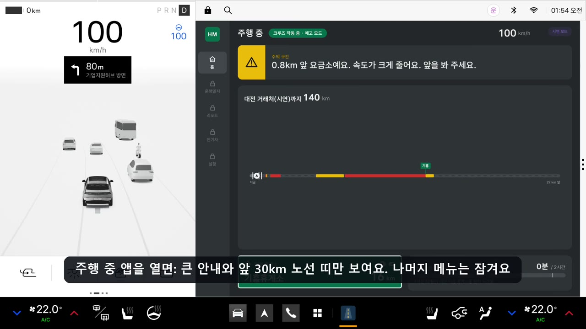
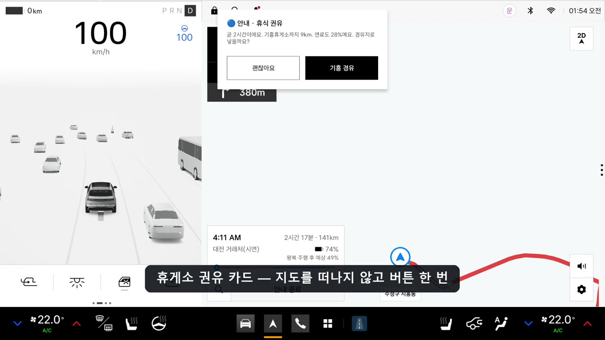
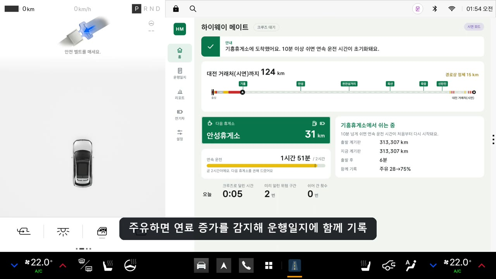
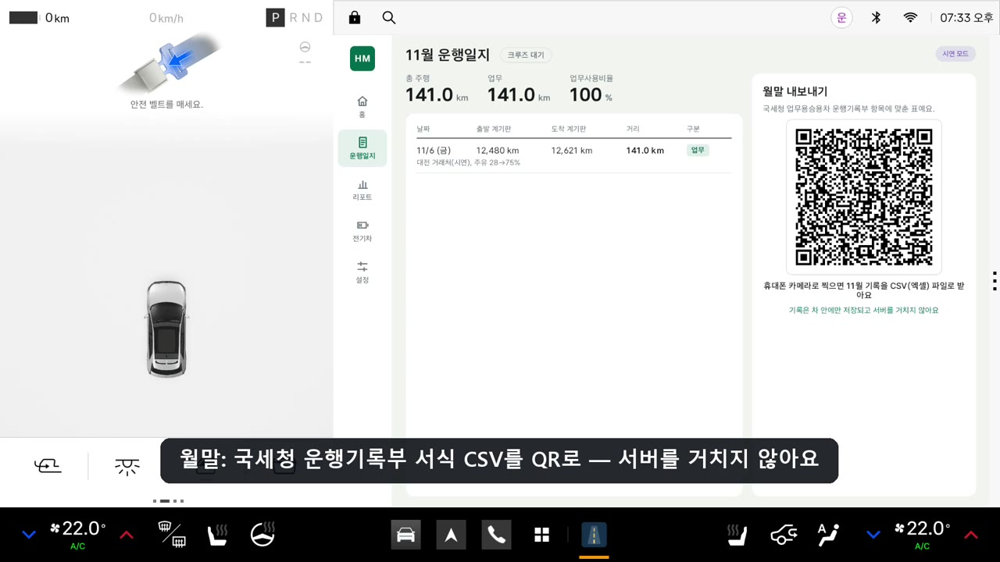

# 하이웨이 메이트 (Highway Mate)

**주행보조를 켜고 달릴 때 위험 구간 전에 미리 깨워 주고, 쉬어야 할 때 휴게소를 경유지로 넣어 주며, 운행기록부는 계기판 값으로 알아서 써 주는 업무 운전자의 차 안 파트너입니다.**

Pleos Connect(Android Automotive OS, API 34)용 프로토타입입니다. 「현대자동차그룹 차량용 앱 개발 공모전」 제출용입니다.

| 주행 중 앱 화면: 큰 안내와 앞 30km 노선 띠 | 주행 중 내비 위 카드: 휴게소 경유지 버튼 한 번 |
|---|---|
|  |  |
| **정차 중 홈: 전체 노선, 다음 휴게소, 연속 운전** | **운행일지와 월말 운행기록부 QR** |
|  |  |

시연 영상: [docs/demo.mp4](docs/demo.mp4) (2분 41초, 에뮬레이터 화면 녹화, 자막·알림 소리 있음)

화면은 고속도로 안내표지에서 가져왔어요. 초록은 길 안내와 휴게소, 노랑은 주의 구간, 빨강은 위험이에요. 주행 중에는 어두운 아스팔트 화면으로 바뀌고, 리포트·운행일지·설정은 잠겨요.

---

## APK

- **[apk/HighwayMate_release.apk](apk/HighwayMate_release.apk)**: release 빌드이고 서명돼 있어요.
  - 파일 이름: 제출 규칙은 `팀명_앱이름_release.apk`이지만, 개인 참가는 팀명이 성명이라 실명이 드러나요. 접수양식의 「첨부자료에 개발자 실명이 노출되지 않도록」 안내를 따라 팀명 자리를 비우고 앱 이름만 붙였어요.
- 패키지명: `ai.highwaymate`

## 실행 방법

1. Pleos Connect Emulator(v2.1.0 이상)를 켭니다.
2. APK를 설치합니다.
   ```bash
   adb install -r -g apk/HighwayMate_release.apk
   ```
3. 앱 목록에서 「하이웨이 메이트」를 엽니다.
   - 처음 열면 속도 권한(시스템 창에는 「위치 정보 액세스」로 표시)을 묻습니다. 허용하세요.
   - 앱은 상주 서비스로 시작합니다. 내비가 앞에 있어도 차량 신호를 받습니다.
4. Virtual Console이나 **시연 패널**로 상황을 만듭니다. 시연 패널은 기본으로 숨겨져 있어요. 설정 화면 맨 아래 버전 글자를 다섯 번 누르면 열려요.
   - 「경로: 대전」을 누르면 실제 NaviHelper로 경로를 요청합니다.
   - Virtual Console에서 기어 D, 속도, Cruise Control State를 **Full autonomous**로 바꾸면 크루즈 「작동」이 됩니다.
   - 내비 화면 위에 예고 카드가 뜹니다.

### 시연 영상과 같은 장면을 스크립트로 재현

```bash
bash demo/demo.sh setup    # 초기화
bash demo/demo.sh part1    # 출발 → 정체·요금소 예고 → 휴게소 권유 → 경유지 추가 → 휴게소 도착·주유
bash demo/demo.sh part2    # 휴식 → 도착 → 운행 자동 기록 → 업무 분류 → 월말 QR → 알림 설정 → 전기차 절전
```

- `REC=1`을 붙이면 화면을 녹화합니다. `python -I demo/make_video.py demo/out demo/out/하이웨이메이트_시연.mp4 hm_part1 hm_part2`로 자막과 알림 소리를 입힙니다.
- 에뮬레이터 녹화에는 소리가 담기지 않습니다. 그래서 `demo/sounds/<part>.tsv`에 적은 시점(알림 카드가 뜬 시각)에 알림음과 안내 음성(Windows 한국어 음성 Heami)을 다시 합성해 넣습니다. 다시 녹화하면 이 시각을 고쳐야 합니다.
- 스크립트는 Virtual Console의 HTTP API로 기어·속도·크루즈·누적거리를 바꿉니다. 그래서 앱은 이 값을 **실제 Pleos SDK 경로로** 받습니다.

## 테스트 환경과 필요한 설정

| 항목 | 값 |
|---|---|
| 에뮬레이터 | Pleos Connect Emulator v2.1.0 (`RELEASE.release_connect_v2.1.0`, API 34, x86_64) |
| SDK | Vehicle 2.3.2, NaviHelper 3.0.5 (`https://nexus-playground.pleos.ai/repository/maven-releases/`) |
| 빌드 | Android Gradle Plugin 8.13, Kotlin 2.2.20, Jetpack Compose, JDK 17 이상 |
| 화면 | 2560×1440, 가로 |
| 권한 | Pleos `CAR_*` 조회 권한(설치할 때 자동 허용), `NAVI_ROUTE`·`NAVI_ROUTE_SEARCH`, AAOS `CAR_SPEED`(첫 실행 때 허용) |
| 선택 권한 | `PRIVATE_CAR_SAFETY`(경고등, 보조 신호), `CONTROL_CAR_CLIMATE/SEATS/LIGHTS`(확장 ⑤, 2단계). 없어도 핵심 기능은 동작합니다 |

소스에서 빌드하려면 `local.properties`에 `sdk.dir`를 적고 `./gradlew :app:assembleDebug`를 실행합니다. release 서명 키는 저장소에 넣지 않았습니다.

## 무엇이 실제 SDK이고 무엇이 시뮬레이터인가

시뮬레이터 값을 쓰는 동안에는 화면 오른쪽 위에 「시연 모드」가 표시됩니다. 시연 패널에는 모든 값 옆에 `SDK`와 `SIM` 중 하나를 표시합니다.

| 실제 Pleos SDK로 받는 값 (`SDK`) | 시뮬레이터로 넣는 값 (`SIM`) |
|---|---|
| 기어, 크루즈 상태(ACTIVATED·FORCED_DEACTIVATION_WARNING 등), 계기판 누적거리, 속도(AAOS), SOC | 연료량: 에뮬레이터가 전기차 설정이라 연료 속성이 없습니다 |
| NaviHelper: 경로 요청, 경유지 추가, 경로상 정체 구간, TBT(요금소·분기·휴게소), 도착 예상 배터리, 즐겨찾기 | 시간 배속(×60): 2시간 운전을 영상에 담기 위해서입니다 |
| 공조 온도·풍량, 앰비언트 조명, 실내등 제어(확장 ⑤) | 경로 진행 거리: 에뮬레이터의 차 위치가 움직이지 않아서입니다 |
| 경고등(DAW 등): 권한이 있을 때만 받습니다 | 운전자 주의 경고 표시등: Virtual Console에 카드가 없습니다 |

## 구조

```
app/src/main/java/ai/highwaymate/
├─ MonitorService.kt     상주 포그라운드 서비스: 1초마다 판단, 내비 위 알림 카드(헤드업), 시연 명령
├─ core/VehicleBridge.kt Vehicle SDK · AAOS Car API · NaviHelper 연결
├─ core/Engine.kt        판단 엔진: ① 크루즈 작동 중 위험 구간 예고 ② 휴식 코치 ③ 운행 기록, 알림 상한
├─ core/TripLog.kt       운행일지(기기 안에만 저장), 국세청 운행기록부 서식 CSV
├─ core/PowerSave.kt     확장 ⑤ 전기차 절전 단계(운전자가 고름, 시야 관련은 건드리지 않음)
├─ core/Voice.kt         음성 또는 효과음(주의 띵 한 번, 위험 띵띵띵), 오디오 포커스
├─ core/Settings.kt      알림 방식과 알림 종류 설정
├─ ui/Screen.kt          화면: 왼쪽 메뉴(홈·운행일지·리포트·전기차·설정), 주행 중 화면, 시연 패널
├─ ui/RouteStrip.kt      노선 띠: 경로의 정체·휴게소·요금소·내 위치를 한 줄로
└─ ui/Theme.kt           색과 아이콘(고속도로 안내표지 색)
```

## 설계 원칙

- **주행 중에는 지도가 주인공입니다.** 앱은 뒤에서 돌고, 짧은 소리와 내비 위 카드로만 알립니다. 휴게소 경유지 버튼도 카드에 있습니다.
- **알림 상한을 둡니다.** 같은 종류는 10분에 한 번, 전체는 1시간에 4번까지만 알립니다. 위험(빨강)은 예외입니다.
- **감지는 순정이, 예고와 다음 행동은 앱이 맡습니다.** 앱은 운전자 시선을 보지 않습니다. 대신 위험 구간을 **미리** 알립니다.
- **기록은 차 안에만 저장합니다.** 회사로 넘기는 것은 운행일지(거리·업무 구분)뿐입니다. 안전 습관 데이터는 운전자 본인만 봅니다.

## 알려진 한계 (프로토타입)

- 휴게소 좌표는 시연 경로(경부고속도로 하행)의 샘플 근삿값입니다. 제품에서는 한국도로공사 공공데이터를 씁니다. NaviHelper에는 장소 검색이 없습니다.
- 에뮬레이터에는 TTS 엔진이 없어서 효과음으로 안내합니다. Pleos TextToSpeech SDK가 열리면 음성으로 바꿉니다.
- 크루즈 「작동」 판정은 에뮬레이터의 Full autonomous 모드로 확인했습니다. 실차의 HDA가 같은 값을 주는지는 확인이 필요합니다.
